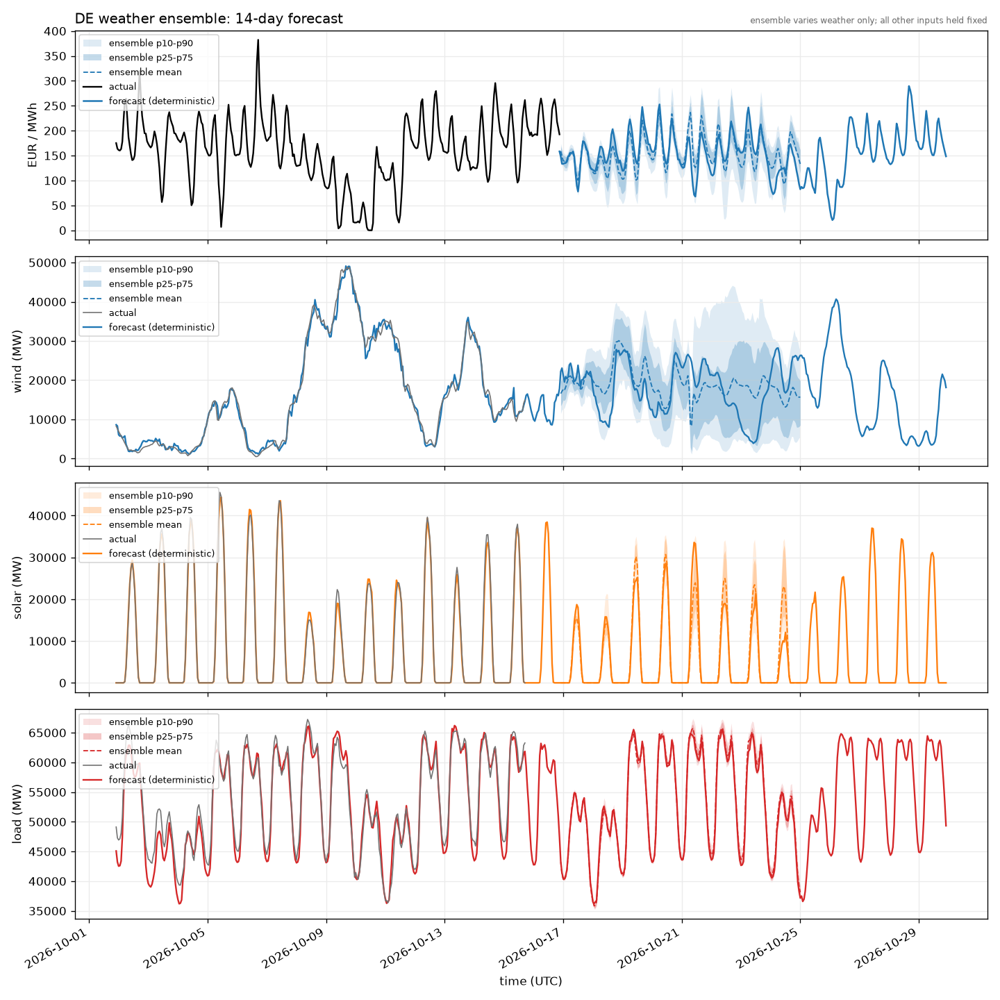

# Weather ensemble forecasts

The weather ensemble shows how the German price, wind, solar and load forecasts change under
51 ECMWF weather scenarios. Each member passes through the same trained model chain: weather to
wind, solar and load, then to the German price NN. The outputs are combined after prediction.



This committed image is a static example and may lag the latest code and data.

## Reading the figure

- **Black or grey:** measured values.
- **Dashed coloured line:** the average prediction across ensemble members.
- **Darker band, p25-p75:** the middle 50% of member predictions.
- **Lighter band, p10-p90:** the middle 80% of member predictions.

Wider bands indicate greater disagreement between weather scenarios. Price is in EUR/MWh; wind,
solar and load are in MW. Time is UTC. The deterministic forecast has its own
[price](data/forecast/forecast.png) and [fundamentals](data/forecast/fundamentals.png) figures.

Each series begins after its own last actual, subject to complete member-weather coverage. Wind,
solar and load can therefore start before price, whose day-ahead auction may already have settled
tomorrow's values. Bands end when the required member weather runs out, which can be earlier than
the deterministic forecast.

## What the bands measure

The bands show **weather-driven spread only**. The trained models and other inputs are held fixed.
They do not include model error, unexpected plant outages, demand shocks or every other source of
forecast error. They are not calibrated predictive intervals: a p10-p90 band does not establish an
80% chance that the eventual actual value will fall inside it.

The mean is an average across weather scenarios, so it can have gentler peaks than an individual
member. No temporal smoothing is applied to the predictions.

## Generate the ensemble

After completing the [initial setup](README.md#first-forecast) and training the models, run from
the activated environment:

```cmd
eex forecast --ensemble --plot
```

To refresh inputs and retrain before generating both forecast products:

```cmd
eex run --train --plot --write-db --ensemble
```

The ensemble adds `data/forecast/forecast_ensemble.png` and `forecast_ensemble.csv`. The CSV contains
each model's mean and p10/p25/p50/p75/p90, plus member counts. A target's columns remain empty until
its own forecast starts. Fetching the member weather takes a few minutes because requests are paced.

The deterministic forecast is written first. An ensemble failure is logged and does not prevent
that forecast from being published.

For source variables, coverage checks, API limits and the two ensemble databases, see the
[ensemble source contract](docs/data-pipeline.md#weather-ensemble) and
[forecast output contract](docs/data-pipeline.md#forecast-outputs).
