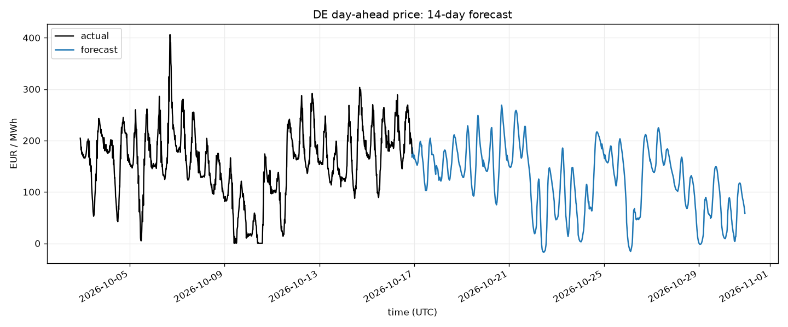
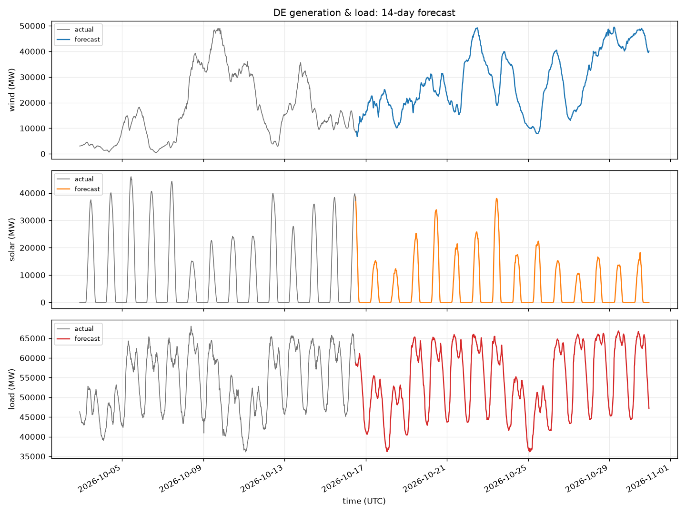

# eex-price-forecast

> **15-minute development branch.** Wind, solar, load and price forecasts use quarter-hour delivery intervals. Price learns within-hour variation through explicit calendar inputs and supervised price changes. Follow [the migration guide](QUARTER_HOURLY.md) for isolated files and retraining, and [quarter-hour results](RESULTS_15MIN.md) for the current evidence.

Short-term **German day-ahead electricity price forecasting** for the EEX / EPEX SPOT DE-LU bidding
zone. The package forecasts up to 14 unknown German delivery days from ECMWF weather, German
wind/solar/load fundamentals, and cross-border market drivers.





> Quarter-hour outputs from the refreshed, retrained pipeline. Price uses the adopted quarter-hour feature/loss update; fundamental parameters remain transferred from the hourly baseline.

## What it does

`eex-price-forecast` provides a Python 3.11+ package and an `eex` command-line interface that:

1. backfills German prices, generation, load, capacity, weather, nuclear availability, and transfer
   capacity into SQLite;
2. forecasts wind, solar, and load from ECMWF weather with three XGBoost sub-models;
3. forecasts German day-ahead price with a neural network using those fundamentals, calendar and lag
   features, German weather, and cross-border conditions;
4. writes a forecast CSV and optional price, fundamentals, and driver plots;
5. optionally propagates ECMWF's 51-member weather ensemble through the same trained models to show a
   weather-driven spread around the forecast;
6. includes reproducible walk-forward evaluation and experimentation tools for model development.

Actuals and forecasts always use separate database and CSV columns, so prediction never overwrites a
measurement.

## Model overview

```text
ECMWF weather
      │
      ├──> wind model ──┐
      ├──> solar model ─┼──> price model ──> DE day-ahead price
      └──> load model ──┘          ▲
                                   │
                 price lag + calendar + neighbour wind
                 + French nuclear + transfer capacity
```

Wind and solar learn capacity factors and are converted back to MW using ENTSO-E installed capacity.
The adopted German wind anchors are 20 geographically diverse points at roughly 135 km minimum spacing.
Solar combines irradiance components, cloud cover, deterministic solar geometry, the installed
capacity (so the model can tell fleet eras apart as output per unit of capacity drifts), and a physical
zero-generation constraint in darkness.

The price model is a DE-only neural network with two 64-unit SiLU layers, trained for 40 fixed epochs.
It predicts prices directly, with no output smoothing or peak scaler. The fundamentals remain
XGBoost models. The price model uses their forecasts where future actuals are unavailable. It also sees:

- the 168-hour price lag where it exists at serve time;
- German market-local calendar, holiday and regime-gated quarter/hour features;
- German weather aggregates;
- neighbour wind for DK, NL, PL, FR, BE, CH, CZ, and AT;
- French scheduled nuclear availability;
- the transfer capacity into Germany on each of its nine borders.

All stored timestamps are UTC. Calendar features are derived in `Europe/Berlin` so local midnight,
weekends, holidays, and daylight-saving transitions match the German market.
Price training combines level MAE with observed changes between adjacent native quarters inside
each hour, at weight 0.25. It learns these movements directly; no jitter is added to predictions.

## Quickstart

### Install

Create and activate a virtual environment:

```bash
python -m venv .venv
```

| Shell | Activation command |
|---|---|
| Windows `cmd.exe` | `.venv\Scripts\activate` |
| Windows PowerShell | `.venv\Scripts\Activate.ps1` |
| macOS/Linux bash or zsh | `source .venv/bin/activate` |

Install the package and create the local environment file:

```bash
pip install -e ".[dev]"
copy .env.example .env.local                # use cp on macOS/Linux
```

Set `ENTSO_E_API_KEY` in `.env.local`. The key comes from the
[ENTSO-E Transparency Platform](https://transparency.entsoe.eu/).

### First forecast

The repository contains selected weather points and adopted price parameters. Fundamental settings
are transferred from the hourly baseline. Starting from an
empty local database:

```bash
eex db init
eex backfill entsoe --start 2023-01-01      # targets, actuals, and installed capacity
eex backfill weather --start 2023-01-01     # history at the committed weather points
eex backfill nuclear --start 2023-01-01     # French nuclear availability
eex backfill ntc --start 2023-01-01         # cross-border transfer capacity
eex update                                  # refresh the most recent actuals and weather
eex model train                             # train wind, solar, load, and price
eex forecast --plot                         # write data/forecast_15min/*
```

The database and trained model artifacts are local runtime files and are not committed.
PyTorch is a required dependency. Price state is saved as `data/models_15min/price.npz`; fundamentals use
`wind.json`, `solar.json` and `load.json`. All have feature-order sidecars. Existing installations must
reinstall the package and run `eex model train` after the neural migration: legacy price trees are
never used as a fallback.

To generate and rank your own weather candidates or tune different model configurations, follow the
[experimentation guide](docs/experimentation.md).

## Routine operation

Once the database and model artifacts exist:

```bash
eex run --train --plot
```

This refreshes recent ENTSO-E and historical-weather data, retrains all four models, fetches forward
weather and known-ahead drivers, and writes a fresh forecast.

The individual steps are also available:

```bash
eex update                                  # refresh recent history only
eex model train                             # retrain all models
eex forecast --plot                         # forecast with existing model artifacts
```

Retraining is the sensible daily default. A forecast-only run is useful when the artifacts are already
fresh.

Both `eex run` and `eex forecast` accept `--ensemble`, which adds the weather-ensemble spread described
in [Weather ensemble](#weather-ensemble-optional) below:

```bash
eex run --train --plot --ensemble
```

> Retrain after changing features, weather points, feature semantics, or hyperparameters. Persisted
> feature order protects column alignment, but it cannot make an artifact trained under old semantics
> valid under new ones.

## Forecast output

`eex forecast` writes `data/forecast_15min/forecast.csv` containing:

- `price_actual_eur_mwh` and `price_forecast_eur_mwh`;
- `wind_actual_mw` and `wind_forecast_mw`;
- `solar_actual_mw` and `solar_forecast_mw`;
- `load_actual_mw` and `load_forecast_mw`.

`--plot` adds:

- `forecast.png` — settled price followed by the genuinely out-of-sample price forecast;
- `fundamentals.png` — wind, solar, and load actuals followed by forecasts;
- `drivers.png` — weather, neighbour wind, nuclear, and transfer-capacity panels;
- `features.png` — every raw column the models read, as stored and grouped by kind: a quick visual
  sanity check.

`--write-db` also stores forecasts in SQLite without touching actual columns.

The forward window begins 15 minutes after the final published day-ahead price and targets the next 14
unknown German delivery days. If ECMWF ends partway through the final delivery day, the incomplete day
is discarded rather than padded with missing weather.

The available horizon depends on auction settlement, the current ECMWF run and German day
boundaries. Settling another day moves the unknown window forward without extending weather
coverage. The run logs its actual coverage and drops an incomplete final delivery day; inspect the
CSV's last timestamp rather than assuming that every run publishes all 14 days.

### Weather ensemble (optional)

Run the trained model chain for 51 ECMWF weather scenarios to produce ensemble means and bands:

```cmd
eex forecast --ensemble --plot
```

See [Weather ensemble forecasts](ENSEMBLE.md) for the figure, how to read the bands, their
limits and output files. The bands describe weather-driven spread, not calibrated prediction
intervals. The deterministic forecast is written first and remains available if the ensemble fails.

## Evaluation

The package includes frozen-cutoff, D+1 walk-forward tools:

```bash
eex analyze eval                            # full weather -> fundamentals -> price chain
eex analyze oracle                          # isolate downstream fundamental effects
eex analyze shap                            # model explanations: neural IG / fundamental TreeSHAP
eex analyze ablation --target price         # remove features and measure the change
eex analyze aggregation wind                # compare weather representations
eex analyze anchors wind                    # compare anchor selections (also load / solar)
eex model tune --target wind                # Optuna tuning with incumbent protection
eex analyze eval --holdout --seeds 1 --plot # report the adopted configuration on holdout days
```

Two sets of frozen delivery days are scored. Every modelling choice - tuning, aggregation, ablation,
anchors, and the end-to-end adoption gate - uses **development** days. The base set has 92 days;
price tuning uses its fixed 22-day native-market subset with at least 90 days of native training
history. The current quarter-hour evaluation is in [RESULTS_15MIN.md](RESULTS_15MIN.md), including
matched development comparisons and the 18-day reporting holdout.

Regenerated on **16 October 2026** with the adopted quarter-hour NN and **seed 42**. These are single-seed
point estimates; the report does not estimate across-seed uncertainty.

| Model | MAE | RMSE |
|---|---:|---:|
| Wind | 1,779.30 MW | 2,161.77 MW |
| Solar | 773.99 MW | 1,345.86 MW |
| Load | 1,808.12 MW | 2,089.67 MW |
| Price | 26.78 EUR/MWh | 41.58 EUR/MWh |


> Each panel is one holdout day: the actual price in black, the D+1 forecast in blue, each on its
> own y-scale. Written by `eex analyze eval --holdout --plot`.

The day panels expose missed negative-price episodes and scarcity peaks, along with better captured
ordinary days. With 18 days, the figure moves noticeably with the sample. The previous hourly
benchmarks and explanations remain in [the historical results](RESULTS.md).

A few things are worth keeping in mind when reading these figures:

- **Only the next delivery day (D+1) is scored.** The published forecast runs to D+14, and weather
  forecast error grows with lead time, so errors further out are likely larger. No multi-day
  accuracy is claimed.
- **The historical weather may be slightly better than what a live run gets.** Open-Meteo's
  archived forecasts stitch together the short-lead segments of successive ECMWF runs, which can
  make D+1 look a little better than the run actually available at issue time.
- **The sample is small.** 18 days, with no October-December delivery days. That cuts both ways: it
  also happens to include several of the period's most extreme price days, so the figure could as
  easily be pessimistic as optimistic for a typical day.

The only way to measure true out-of-sample error is a live track record: archive each run's forecast
and score it against the prices that later settle, daily or weekly, over months. This project
deliberately does not maintain one.

See [Experimentation and evaluation](docs/experimentation.md) for methodology, command options, report
locations, and interpretation.

Price tuning uses the operational NN; there is no backend switch. The
[model development record](docs/model-development.md) explains the adopted configuration, measured
quarter-hour shape/accuracy comparisons and historical benchmarks.

## Documentation

| Document | Purpose |
|---|---|
| [Quarter-hour results](RESULTS_15MIN.md) | Current development comparisons, holdout forecasts and within-hour price detail |
| [Historical hourly results](RESULTS.md) | Earlier hourly holdout forecasts and attribution plots |
| [Experimentation and evaluation](docs/experimentation.md) | Point rebuilding, tuning, aggregation, ablation, eval, oracle, and diagnostics |
| [Weather ensemble forecasts](ENSEMBLE.md) | Ensemble figure, interpretation, commands and limitations |
| [Data pipeline and sources](docs/data-pipeline.md) | Backfill windows, weather variables, timestamp alignment, cross-border inputs, the weather ensemble, and source details |
| [Model development](docs/model-development.md) | Findings, rejected alternatives, decisions, and next research priorities |
| [AGENTS.md](AGENTS.md) | Repository invariants and guidance for coding agents |

## Development

With the virtual environment active:

```bash
ruff check .
ruff format --check .
mypy src
pytest
```

ENTSO-E and Open-Meteo are mocked in the test suite; tests do not require an API key or network access.

Every `eex` invocation also writes a timestamped file under `logs/`. Logs older than
`LOG_RETENTION_DAYS` are pruned on startup; set `EEX_LOG_TO_FILE=0` to disable file logging.

## Data sources

- [ENTSO-E Transparency Platform](https://transparency.entsoe.eu/) — prices, generation, load,
  installed capacity, nuclear outages, and transfer capacity;
- [Open-Meteo](https://open-meteo.com/) — live and archived ECMWF IFS forecasts;
- [Eurostat GISCO](https://ec.europa.eu/eurostat/web/gisco) — country land geometry;
- [Marine Regions](https://www.marineregions.org/) — maritime and EEZ geometry.

Detailed publications, variables, and alignment rules are documented in
[Data pipeline and sources](docs/data-pipeline.md).

## License

Released under the [MIT License](LICENSE) — © 2026 Aleksi Tuulos. Free to use, modify, and distribute;
provided as-is, without warranty.
