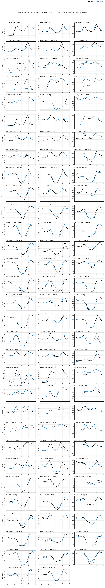

# Forecast results

The German wind, solar and load forecasts use XGBoost models. A DE-only neural network predicts
day-ahead prices from those fundamentals, weather, calendar, price-lag and cross-border inputs.
All forecasts use 15-minute delivery intervals.

## Evaluation scope

The development evaluation covers **39 delivery days**, from 3 October 2025 through 15 September
2026. The reporting holdout covers **18 delivery days**, from January through September 2026.
Each fold trains on earlier data, fits the three fundamental models, forecasts their held-out
values, and supplies those forecasts to price. Only the next delivery day, D+1, is scored.

The [development report](data/evaluation/model_eval.json) is dated 17 October 2026 and the
[holdout report](data/evaluation/model_eval_holdout.json) is dated 18 October 2026. Both use model
seeds **42, 1055 and 2068**. The table averages delivery-day errors, then averages across seeds.
Figures show the first seed, **42**, so each plotted day comes from one coherent fitted chain.

| Model | Development MAE | Holdout MAE | Holdout RMSE |
|---|---:|---:|---:|
| Wind | 1,402.88 MW | 1,599.00 MW | 1,973.99 MW |
| Solar | 718.46 MW | 820.60 MW | 1,427.95 MW |
| Load | 1,717.18 MW | 1,787.55 MW | 2,053.79 MW |
| Price | 14.17 EUR/MWh | 26.31 EUR/MWh | 41.50 EUR/MWh |

The across-seed standard deviation of holdout price MAE is
**1.09 EUR/MWh**. This measures variability across three fits;
it is not a confidence interval for future forecast error.

## Price profiles

Each panel compares actual prices in black with the D+1 forecast in blue. Each day has its own
y-axis. Read the panels for timing, daily shape, negative-price episodes and scarcity peaks as well
as overall price levels.

The NN receives the quarter's position within its hour and interactions with the German daily clock.
Training combines price-level error with error in observed changes between adjacent native quarters
inside an hour. Predictions are direct network outputs in EUR/MWh.

For seed 42, the holdout's within-hour change MAE is **7.96 EUR/MWh**,
and hour-centred shape MAE is **7.25 EUR/MWh**. Mean absolute within-hour
movement is **8.21 EUR/MWh** in the predictions and
**11.12 EUR/MWh** in the actuals. Movement amplitude describes
roughness; change and shape errors measure whether the actual movements were predicted correctly.

## Fundamental forecasts

Wind is reported in MW. Capacity-factor training relates weather to the fraction of installed
capacity producing power, then converts each prediction back to MW.

Solar combines irradiance, cloud cover, geometry and installed capacity. Predictions are constrained
to zero during darkness. Daylight panels show the forecast's cloud sensitivity and peak timing.

Load combines weather with German market-local calendar and holiday features. The day panels expose
errors in working-day, weekend and holiday demand profiles.

The [development oracle report](data/evaluation/oracle_substitution.json) and
[holdout oracle report](data/evaluation/oracle_substitution_holdout.json) switch matched actual and
forecast fundamentals to diagnose their downstream price effects. Only `forecast_all` represents
the production input chain. Signed MAE differences are not additive and can reflect error cancellation.

## Model explanations

Price explanations use integrated gradients relative to training-mean inputs. Each dot represents
one delivery interval. The left panel groups contributions into feature families; the right panel
shows individual inputs. Calendar includes the quarter/hour features. These are learned associations,
not causal effects or evidence of out-of-sample accuracy.

Fundamentals use TreeSHAP in MW: [wind](data/analysis/shap_wind.png),
[solar](data/analysis/shap_solar.png) and [load](data/analysis/shap_load.png). Non-negative clipping
and the solar-darkness constraint are outside the additive explanations.

Generate these figures from the saved operational models with `eex analyze shap --days 30`.
The command logs the numerical completeness error of price attribution.

## Interpretation limits

- D+1 scores do not establish accuracy throughout the 14-day outlook.
- Historical forecast weather stitches short-lead runs and can make absolute D+1 errors optimistic.
- Eighteen holdout days are a small sample, with no October–December coverage.
- Large spikes, deep negative prices and unpredictable quarter-hour movements are difficult to forecast.
- Ensemble bands describe weather-driven spread and do not include every source of price uncertainty.

See [Experimentation and evaluation](docs/experimentation.md) for commands and methodology,
[Data pipeline and sources](docs/data-pipeline.md) for interval semantics, and
[Weather ensemble forecasts](ENSEMBLE.md) for scenario interpretation.
