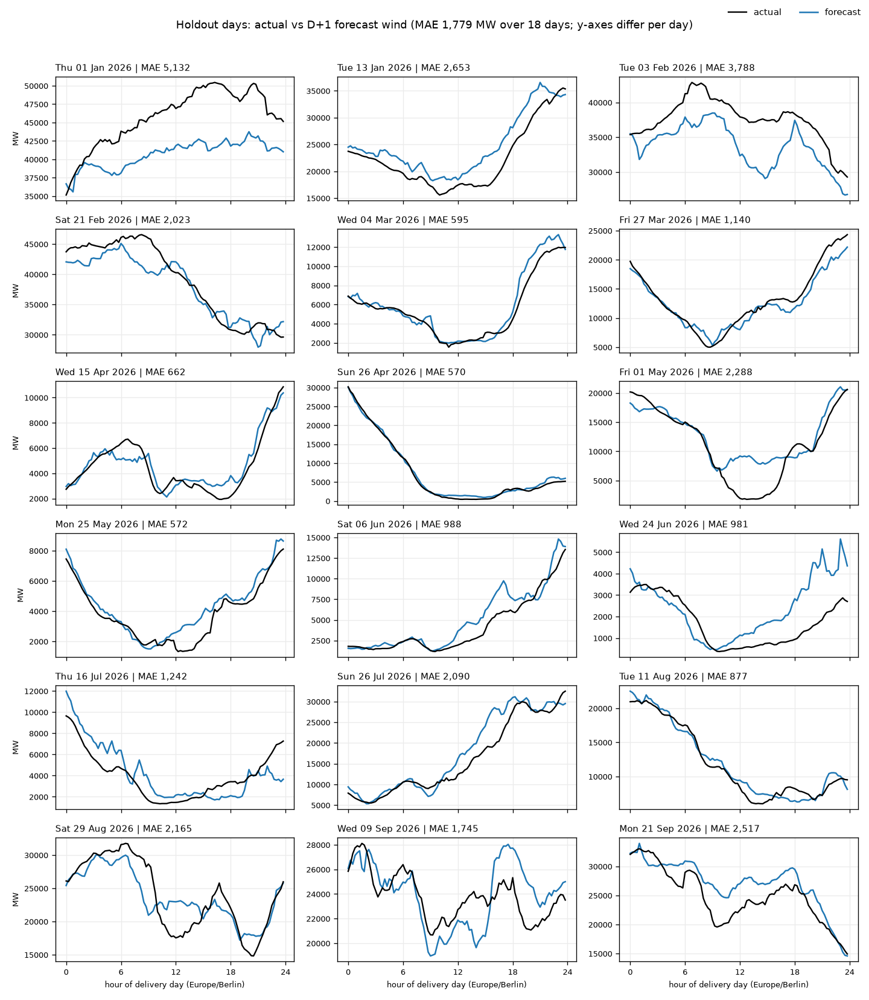
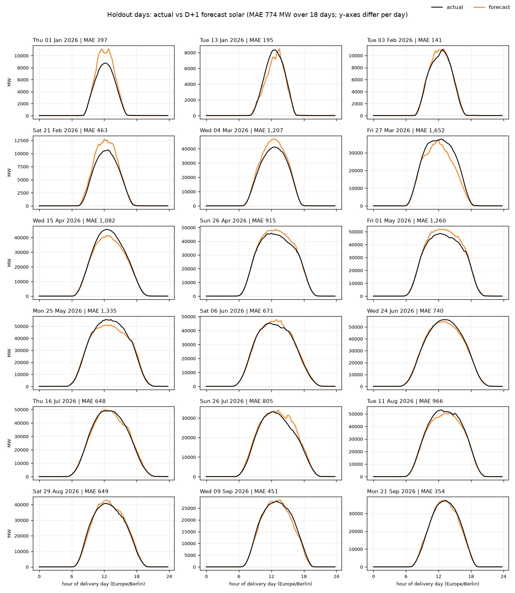
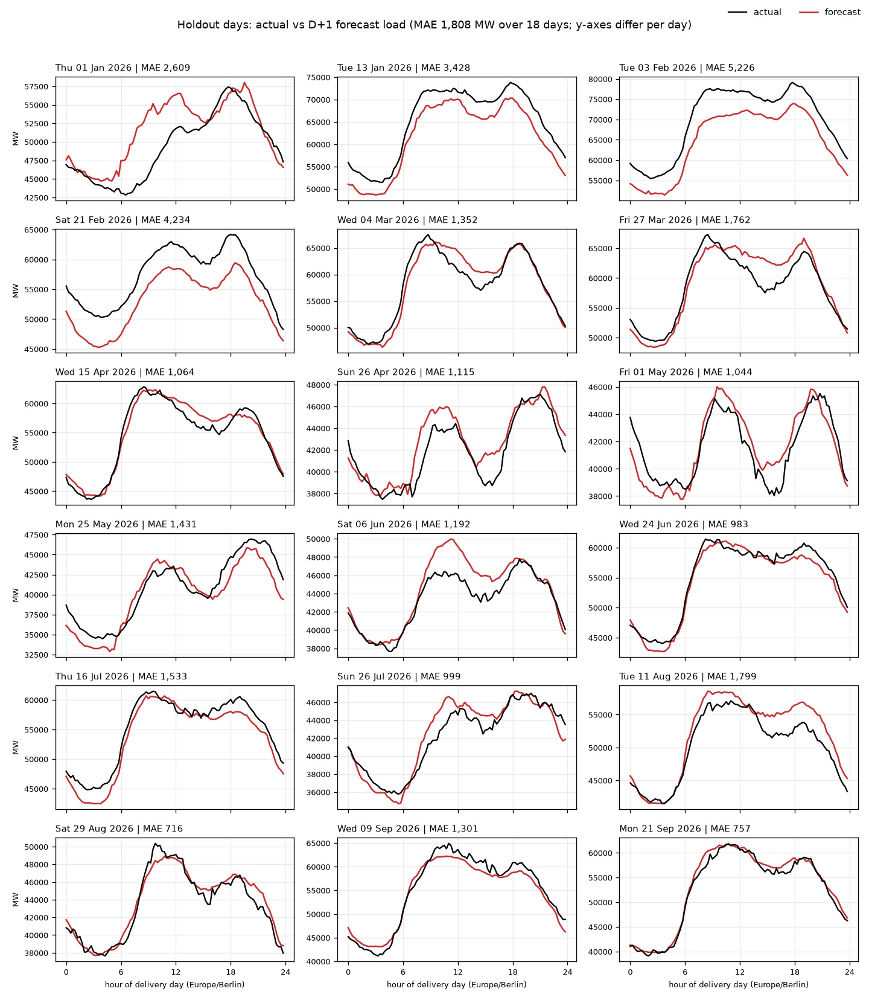
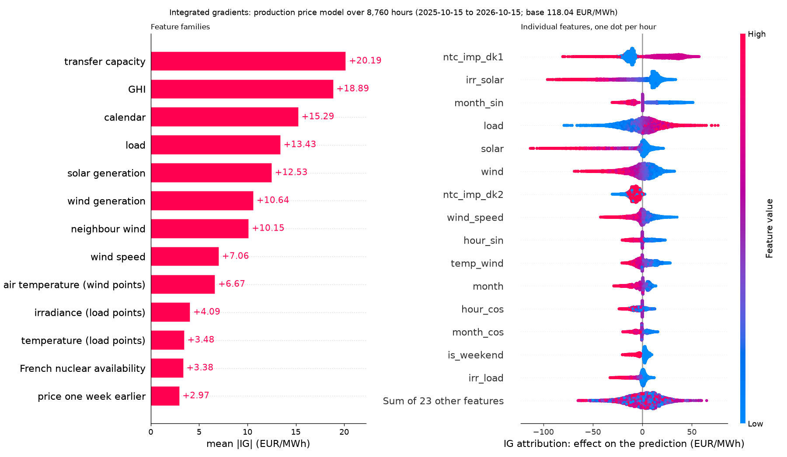
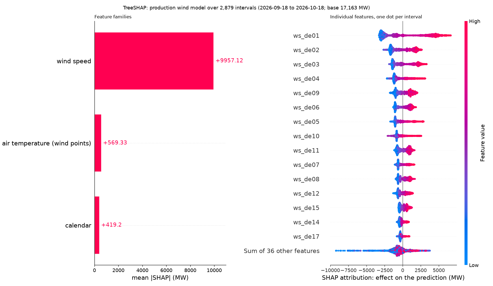
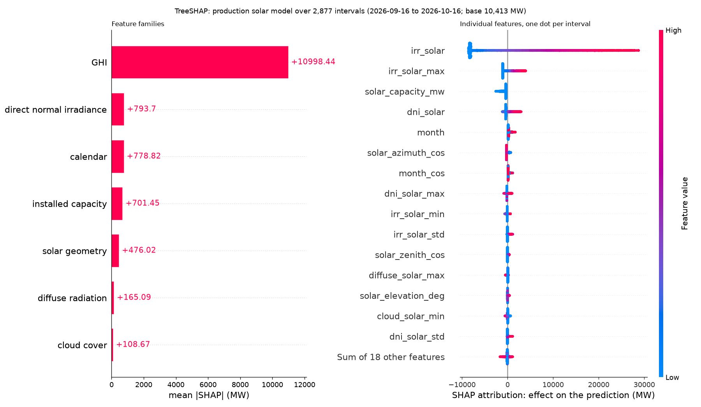
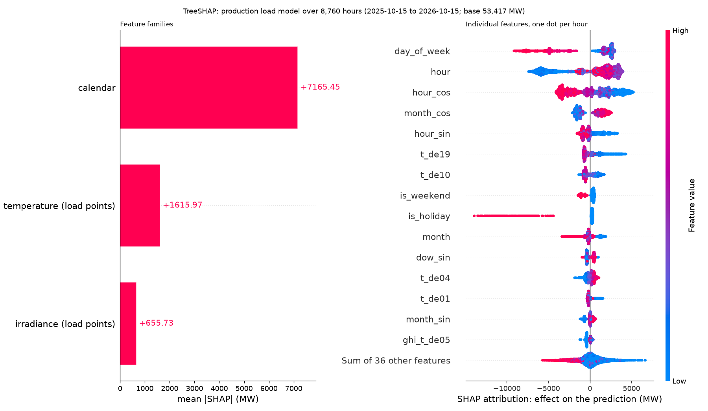

# Results explained

> **Historical hourly baseline.** All figures and numbers on this page describe the hourly model before the 15-minute migration. They do not measure quarter-hour forecast accuracy. Current evidence is in [quarter-hour results](RESULTS_15MIN.md); see also [the migration guide](QUARTER_HOURLY.md).

Updated **15 October 2026** for the operational neural price model.

The project first forecasts German wind generation, solar generation and electricity use (load).
A single-area neural network then predicts the German day-ahead price using those fundamentals,
calendar, weather and market drivers. The three fundamental models remain XGBoost.

The price curves shown here are direct hourly NN predictions. Their continuity comes from the
network's learned response to inputs; no moving average or other output smoothing is applied.
Smoothness and accuracy are separate properties: the adoption study measured a smoother profile
alongside a higher price MAE. Its matched comparison is in the
[model development record](docs/model-development.md#adoption-evidence-and-trade-off).

## Reading the evaluation

The figures below show **18 holdout delivery days from January to September 2026**, using seed 42.
For each day, every model trains on preceding data. The held-out wind, solar and load actuals are
hidden from the price model, which receives that fold's fresh fundamental forecasts. These holdout
results report the already adopted configuration; they did not select it.

The black curve is actual and the coloured curve is forecast. The horizontal axis is German local
time. Each panel has its own vertical scale, so compare the pattern within a day before comparing
heights between panels. All scored days here have 24 hours.

**MAE** is the average absolute miss. **RMSE** gives more weight to large misses. MW measures power;
1,000 MW is 1 GW. EUR/MWh is the electricity price. Neither score measures visual smoothness.

| Model | Holdout MAE | Holdout RMSE |
|---|---:|---:|
| Price | 27.22 EUR/MWh | 41.67 EUR/MWh |
| Wind | 1,793.42 MW | 2,179.38 MW |
| Solar | 817.07 MW | 1,423.09 MW |
| Load | 2,018.92 MW | 2,304.68 MW |

Source: [holdout report](data/evaluation/model_eval_holdout.json). These are single-seed point
estimates. The zero seed spread in that report supplies no across-seed uncertainty estimate.

### Price


The NN catches the broad morning/evening peaks and midday valleys on many days. Examples include
13 January, 3 February and 15 April. It still misses the level or amplitude on difficult days:

- On 4 March and 24 June the evening rise is present, but much smaller than the actual spike.
- On 26 April and 1 May it predicts negative midday prices but misses the extreme negative troughs.
  Training caps the outer 0.1% of target values at each tail, and MAE training favours typical
  outcomes. This does **not** impose a hard floor or ceiling on the NN's predictions.
- On 1 January the forecast stays above the near-zero actual prices for much of the day.
- On 26 July and 29 August the forecast goes below zero while actual midday prices remain near zero.

The three days 26 April, 1 May and 24 June account for **43.0%** of total price error. Excluding them
would give **18.62 EUR/MWh** MAE; the reported headline includes them. The median day's MAE is
**16.09 EUR/MWh**. This illustrates how strongly an 18-day score depends on its extreme days.

The [error breakdown](data/evaluation/model_eval_breakdown_holdout.json) records an overall price
bias of **-8.55 EUR/MWh**. Negative-price hours account for 9.7% of hours and 26.9% of error; prices
of at least 250 EUR/MWh account for 2.1% of hours and 15.3% of error. Smooth profiles therefore still
need better extreme-regime predictions.

### Wind generation



The average absolute miss is **1,793 MW**. The model generally follows weather-driven rises and
falls, while some very windy winter days have larger errors in level. A timing or strength error
in the weather forecast passes through to generation. The model learns generation as a fraction
of installed capacity and converts it back to MW, allowing the fleet size to change over time.

### Solar generation



The average absolute miss is **817 MW**. The daylight arc is generally recognizable, with errors
around the midday peak on some days. Nighttime zero is an explicit physical constraint when all
aligned irradiance points are dark; it is not something to credit to statistical accuracy.
Generation is capacity-scaled. Irradiance intervals are aligned to delivery hours, and the model
also receives solar geometry, diffuse/DNI radiation and cloud information.

### Load



The average absolute miss is **2,019 MW**. Calendar and temperature help reproduce the day/night
and working-day patterns. Exceptional days, especially around holidays, can differ substantially
from the learned pattern. Load errors also reach the price network: the oracle comparison below
shows their downstream effect on this sample.

## What the fundamental errors contribute to price

The [holdout oracle report](data/evaluation/oracle_substitution_holdout.json) reuses each fitted
price model and substitutes measured or forecast fundamentals on the same hours.

| Price inputs | Price MAE | Change from all measured |
|---|---:|---:|
| All fundamentals measured | 25.28 EUR/MWh | reference |
| Only wind forecast | 25.98 EUR/MWh | +0.70 EUR/MWh |
| Only solar forecast | 25.01 EUR/MWh | -0.27 EUR/MWh |
| Only load forecast | 27.03 EUR/MWh | +1.75 EUR/MWh |
| All three forecast | 27.22 EUR/MWh | +1.94 EUR/MWh |

Measured fundamentals are an impossible live oracle. Load has the largest isolated penalty here.
The small negative solar delta reflects error cancellation in this finite sample. Deltas do not add
up because the NN is nonlinear and input errors interact. The all-forecast row matches evaluation.

## What the saved models use

These explanations describe the final saved production models over the most recent 365 days with
available targets. They use measured historical fundamentals and are **not** held-out accuracy tests.
The left panel groups features and ranks their average absolute contribution; the right panel puts
one dot per hour at its individual feature contribution. Colour indicates the input's raw value.
Contributions describe learned associations, not causes.

### Price: integrated gradients



Price uses **integrated gradients (IG)** through the actual NN. Its reference is the training-mean
standardized input with all missingness flags cleared. Value and missingness contributions are
combined for each original input. The method follows the path from that reference to each hour's
inputs and measures how much each feature contributes to the price difference.

<!-- price-attribution-reading:start -->
The largest grouped contributions in this window are transfer capacity (**20.2 EUR/MWh**), GHI
(**18.9**), calendar (**15.3**) and load (**13.4**), measured as average absolute IG contribution.
Several inputs describing neighbouring wind and domestic generation also contribute. These sizes
are relative to the chosen reference and need not match rankings from the former tree model.

The maximum completeness residual is **0.000052 EUR/MWh**, so the approximate contributions sum
closely to the saved NN's output on these 8,760 explained hours.
<!-- price-attribution-reading:end -->

This baseline choice matters: a contribution is relative to this reference, not a universal price
premium. Historical weekly-lag importance describes hours where that lag exists, rather than the
second forecast week where it is unavailable. Numerical integration is approximate; the regeneration
logs record the maximum difference between the summed contributions plus reference and the NN's
prediction. No residual is redistributed to force an exact sum. Price axes say IG, not SHAP.

### Fundamentals: TreeSHAP



Wind's per-point wind speeds capture regional differences in generation. Temperature and calendar
can supply additional context. The grouped bar combines the effects of all features in a family
within each hour before taking the average absolute value.



Solar uses radiation, geometry, cloud and installed-capacity information. Geometry describes where
the sun can be; radiation and cloud help distinguish clear from cloudy delivery hours. Installed
capacity also identifies different fleet eras in the capacity-factor model.



Load uses calendar, temperature and irradiance to represent schedules, heating/cooling demand and
weather patterns. Correlated inputs can share or substitute for each other's contributions, so a
small bar alone is not a reason to remove a feature.

The fundamental attributions use exact **TreeSHAP**, converted to MW for wind and solar. Their
non-negative clamps and the solar-darkness override are outside that additive explanation.
The common `eex analyze shap` command uses IG for price and TreeSHAP for the three fundamentals.

## Limits and reproduction

All accuracy numbers here cover **D+1**, not the full 14-day forecast. The stitched historical
weather feed can be modestly optimistic relative to a coherent weather run available at issue time.
There are only 18 holdout days, with no October-December coverage. Actual live error requires
archived issue-time forecasts scored after delivery.

Development figures, including [price](data/evaluation/price_eval_days.png), contain 92 days used
for model selection. Their [report](data/evaluation/model_eval.json) is separate from the holdout.
The [pre-NN results](docs/history/results-before-neural-price.md) retain the former model's figures
and numbers; they should not be read as the current model's results.

Reproduce the current artifacts from CMD after activating the environment:

```cmd
eex analyze eval --seeds 1 --plot --breakdown --oracle
eex analyze eval --seeds 1 --holdout --plot --breakdown --oracle
eex run --train --plot --write-db --ensemble
eex analyze shap
```

See [experimentation](docs/experimentation.md) for the evaluation contract and
[model development](docs/model-development.md) for architecture, training and adoption evidence.
