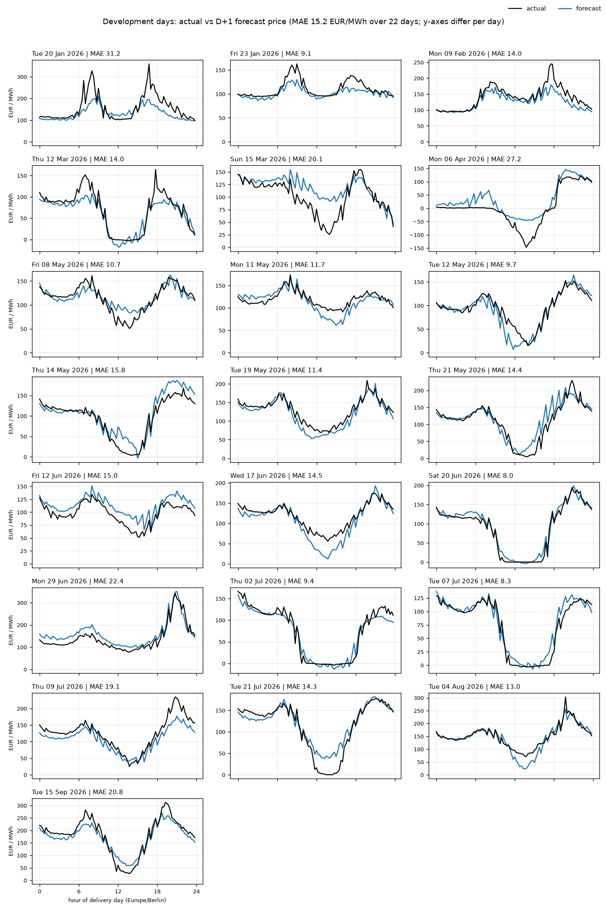
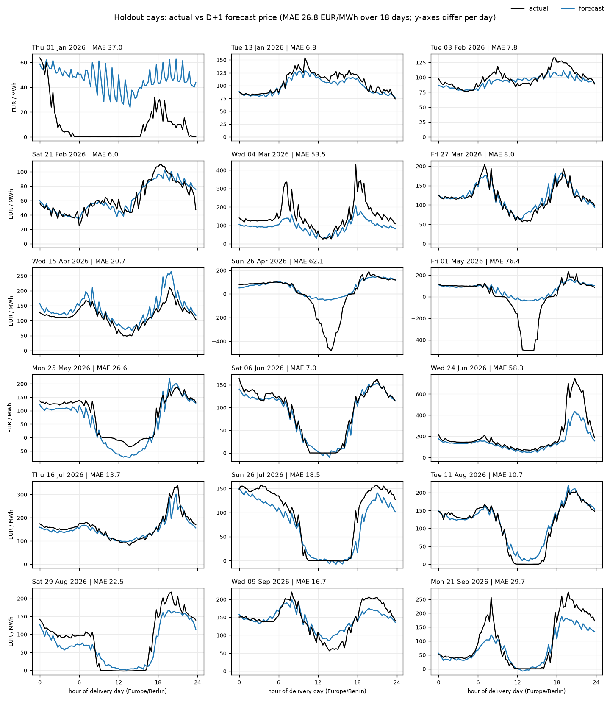
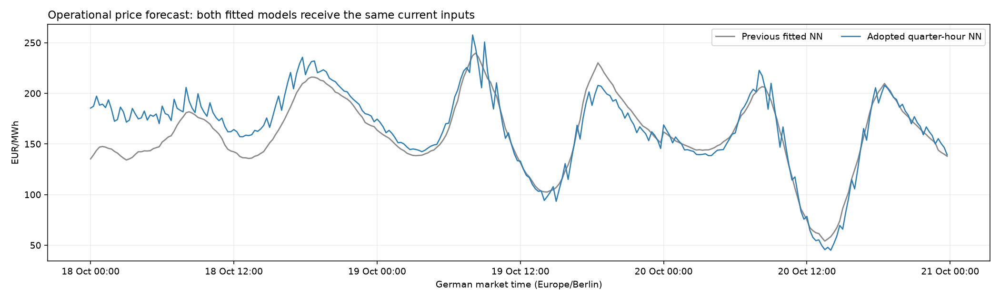
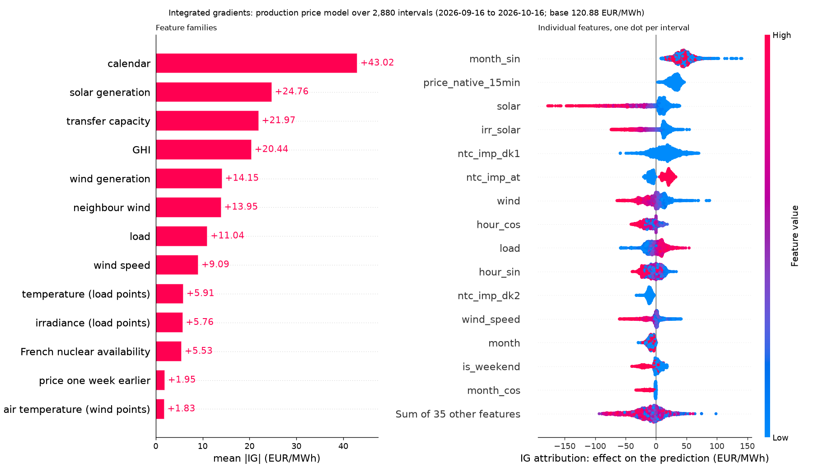

# Quarter-hour forecast results

Updated **16 October 2026** for the DE-only neural price model with explicit quarter/hour inputs and
supervision of observed within-hour changes. Wind, solar and load remain XGBoost. All outputs use
15-minute delivery intervals. The [earlier hourly results](RESULTS.md) score different target
resolution and remain historical reference evidence.

## What changed in the price curve

The first resolution migration produced prices every 15 minutes but missed much of the variation
inside each hour. The adopted update gives the NN the quarter's position and its interaction with
the daily clock, and teaches it to predict the observed changes between adjacent native quarters.
The training history still begins in 2023. No random movement or temporal price filter is applied.

The following comparison uses the same freshly forecast fundamentals for both price models. On
22 native-market development days, the adopted model improves both price accuracy and the accuracy
of quarter-to-quarter changes. All figures in the table are EUR/MWh.

| Measure | Previous NN | Adopted NN |
|---|---:|---:|
| Price MAE | 16.18 | 15.19 |
| Price RMSE | 21.57 | 19.98 |
| Within-hour change MAE | 5.91 | 5.36 |
| Hour-centred shape MAE | 5.48 | 4.71 |
| Predicted mean absolute change within an hour | 3.81 | 7.70 |

Actual mean absolute change within an hour is **8.36 EUR/MWh**. Matching its size alone would not
establish skill; the change-error and shape-error improvements matter too. The price-MAE difference
has a paired-day 90% interval of **[-2.33, +0.32]**, while the within-hour change-error interval is
**[-0.92, -0.19]**. Price accuracy remains more uncertain than the shape improvement on these 22 days.

The first three panels show the first, middle and last development day, with each day's own y-axis.
The final panel removes each hour's mean for a shape diagnostic only; this centring is never applied
to forecast output. The eight-day check over three price seeds also improves price MAE (14.19 to
12.18) and within-hour change MAE (5.43 to 4.80), with identical forecast fundamentals.

The [full adoption report](data/analysis_15min/quarter_price_adoption_experiment.json) records every
grid candidate, scope, seed and day-bootstrap interval. These are development results. The original
width/epoch/optimizer settings and fundamental parameters are carried forward; this update tuned the
quarter-hour feature/loss design rather than every hyperparameter.

## Development and holdout plots

The [development report](data/evaluation_15min/model_eval.json) covers the **22 native-price
development days**, not the full 92-day mixed hourly/native development set. Price tuning uses this
fixed subset with at least 90 days of native price history before each delivery day. The historical
training rows are retained.

The reporting holdout is the 18 frozen delivery days from January through September 2026. The model
choice was recorded before it was run. Its report and figures describe the fixed adopted chain;
they did not choose the model. Each panel compares actual prices in black with the D+1 forecast in
blue, with a separate y-axis for each day.

| Model | Holdout MAE | Holdout RMSE |
|---|---:|---:|
| Wind | 1,779.30 MW | 2,161.77 MW |
| Solar | 773.99 MW | 1,345.86 MW |
| Load | 1,808.12 MW | 2,089.67 MW |
| Price | 26.78 EUR/MWh | 41.58 EUR/MWh |

These are single-seed estimates (42), with no across-seed uncertainty estimate. On the holdout,
within-hour change MAE is **7.87 EUR/MWh**; predicted mean absolute change is **8.16** versus observed
**11.12**. The model still misses some detail. On 1 January it predicts repeated movements through
hours where actual prices are flat; on 26 April and 1 May it misses deep negative-price episodes;
on 4 March and 24 June it underpredicts large peaks. These are reported limitations of the adopted
model, not inputs to another selection round.

The [holdout report](data/evaluation_15min/model_eval_holdout.json) and
[matched oracle diagnostic](data/evaluation_15min/oracle_substitution_holdout.json) provide the
per-day scores and isolate the effect of forecast wind, solar and load.

## Current forecast and limits

The refreshed pipeline saves the adopted model under `data/models_15min/price.npz`, writes the
deterministic products under `data/forecast_15min/`, and propagates the same NN through each weather
ensemble member. The [operational audit](data/analysis_15min/quarter_price_operational_experiment.json)
checks its quarter-hour feature contract, direct NN prediction values and preservation of actuals.

This three-day view verifies the changed operational profile. It is a qualitative forecast comparison,
not an accuracy test: both fitted models receive identical current inputs, but their training
snapshots differ. The matched development comparisons above control the training cutoff as well.

## Model explanations

The following integrated-gradients figure was regenerated from the adopted saved price NN over the
last 30 days of target-bearing history (2,880 quarter-hours). Each dot is one interval. The left panel
sums related inputs into families; calendar includes the quarter/hour features. These are learned
associations relative to training-mean inputs, not causal effects. Large contributions to an overall
price level do not by themselves identify the source of its within-hour changes.

The same run regenerated TreeSHAP figures for [wind](data/analysis_15min/shap_wind.png),
[solar](data/analysis_15min/shap_solar.png) and [load](data/analysis_15min/shap_load.png), in MW. Their
scored interval counts can differ slightly because the upstream actual series end at different times.
The command was `eex analyze shap --days 30`. The neural integration's maximum completeness residual
was below 0.001 EUR/MWh; no residual was redistributed to force exact sums.

## Interpretation limits

- The evaluation scores D+1 only. It does not establish accuracy throughout the 14-day outlook.
- Historical forecast weather is assembled from short-lead runs, which can make D+1 scores modestly
  optimistic. Matched comparisons remain useful.
- Eighteen holdout days are a small sample and do not cover October through December. Large spikes,
  negative-price episodes and unpredictable quarter-hour movements remain difficult.
- The ensemble bands represent weather-driven spread, not every source of price uncertainty.

Commands and methodology are in [Experimentation and evaluation](docs/experimentation.md), with
source/time-grid contracts in [the migration guide](QUARTER_HOURLY.md).
