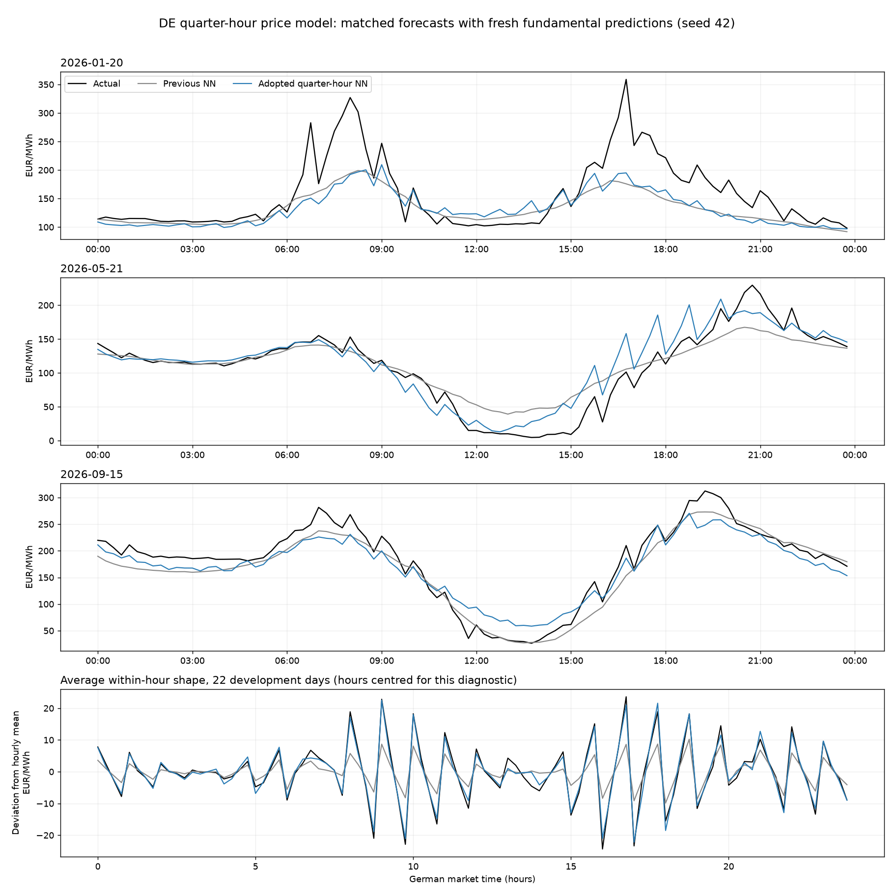

# Model development and current decisions

Last updated: **2026-10-16**.

Development now uses the 39 selected native-price dates from 3 October 2025 through
15 September 2026 for every model, with no minimum native-history age. The 18 holdout dates are
unchanged. Retuning and evaluation on the new calendar are pending; the studies and recorded
benchmarks below keep their original scopes.

The operational price model is a **single-area neural network for Germany**. Wind, solar and load
remain XGBoost models. There is no price-backend option, tree fallback, output smoothing or peak-price
scaler. Public commands and forecast columns retain their existing meanings.

## Quarter-hour price-shape screen (16 October 2026)

This initial screen preceded the adopted training-objective update in the following section.

The initial quarter-hour forecast was too smooth within many hours. This is model behaviour, not
interpolated price output: saved prices match direct NN predictions. About 72.5% of the latest training
labels are legacy hourly prices repeated across their four quarters. The fractional calendar and
interpolated weather provide gradual inputs, but do not directly encode position within each hour.
Native development data also shows systematic within-hour patterns, so the missing variation cannot
all be dismissed as unpredictable noise.

The price-only screen uses 22 frozen development days with at least 90 days of native-price history
before each cutoff. It compares the initial model, four quarter indicators, native-only price history,
their combination, and explicit quarter/hour interactions gated to the known native market regime.
All retain the single DE SiLU NN and the initial parameters. Fundamentals are actual in this screen;
these are conditional price-model diagnostics, not end-to-end forecast scores. Reserved holdout days
are untouched. Training, clipping, preprocessing and lag masks use the shared walk-forward engine.

The [full report](../data/analysis/quarter_price_shape_experiment.json) and
[comparison figure](../data/analysis/quarter_price_shape.png) record price MAE, quarter-to-quarter
change error and hour-centred shape error. Visual roughness alone is not an adoption criterion.
This is a one-seed exploratory screen. Native-only fits also have fewer optimizer updates at the same
40 epochs, so it does not settle the best history window after a matched retune. Any adoption needs
multiple seeds and a comparison with freshly forecast fundamentals.

All values below are EUR/MWh; lower errors are better. Observed mean absolute changes inside an hour
are **8.36**, averaged equally across the 22 delivery days.

| Price variant | Price MAE | Predicted absolute change inside hour | Within-hour change MAE | Hour-centred shape MAE |
|---|---:|---:|---:|---:|
| Initial NN | 15.45 | 3.92 | 5.74 | 5.28 |
| Quarter indicators | 16.78 | 5.37 | 5.78 | 5.24 |
| Native history only | 15.34 | 3.71 | 5.94 | 5.52 |
| Native history + quarter indicators | 16.24 | 6.16 | 5.70 | 5.07 |
| Native quarter/hour interactions | 15.05 | 8.39 | 5.99 | 5.25 |

The interaction features restore average movement amplitude and reduce mean price MAE by 0.40, but
the paired day-bootstrap 90% interval for that price difference is **[-1.62, +0.84]**. Individual
within-hour change error rises by 0.26; its interval is **[-0.16, +0.70]**. Matching roughness therefore
does not establish better prediction of the actual movements. Native history alone does not recover
the missing detail at this training budget either. **No price feature or training-window change is
adopted from this screen.** Further work should test native-quarter feature/loss tuning jointly, with
several seeds and forecast fundamentals, before claiming an improvement.

## Quarter-hour price-shape adoption (16 October 2026)

The follow-up retained the single DE network and added 11 calendar inputs: centred quarter indicators,
a linear position within the hour, and its interactions with three daily sine/cosine harmonics. All
are zero in the legacy hourly-price regime. The 50-input production matrix retains every earlier
driver; regional weather inputs and fundamental models are unchanged.

Training now minimises price MAE plus **0.25 times supervised within-hour change MAE**. Only genuine
adjacent native-price quarters inside the same hour supply ramp labels. Missing observations, gaps,
hour boundaries and legacy hourly targets never become ramp pairs. The loss rewards the observed
upward or downward change, including large changes; it does not reward flat predictions. Training
timestamps are passed separately and never become network inputs. Native-price weighting was tested
at four, but **the adopted weight is one**: the full 2023-onward price history is retained unchanged.

A six-day development grid compared the phase inputs alone, native weighting, and ramp weights
0.25/1.0. The selected configuration was then scored on all 22 eligible native development days;
eight non-screen days were also checked with three price seeds (42, 1055, 2068). These are development
comparisons, not fresh holdout days. The three fundamental forecasts were freshly fitted for each
day and held identical across price variants; additional seeds vary price only. Two folds verified
exact feature parity with the canonical hidden-actual evaluation. See the
[complete adoption report](../data/analysis/quarter_price_adoption_experiment.json).

| End-to-end metric (EUR/MWh) | Previous NN | Adopted NN |
|---|---:|---:|
| Price MAE, 22 days / seed 42 | 16.18 | 15.19 |
| All quarter-to-quarter change MAE | 7.56 | 6.23 |
| Within-hour change MAE | 5.91 | 5.36 |
| Hour-centred shape MAE | 5.48 | 4.71 |
| Predicted mean absolute within-hour change | 3.81 | 7.70 |
| Price MAE, eight days / three seeds | 14.19 | 12.18 |
| Within-hour change MAE, eight days / three seeds | 5.43 | 4.80 |

Observed mean absolute within-hour change on the 22 days is **8.36 EUR/MWh**. The paired-day 90%
interval for the price-MAE difference is **[-2.33, +0.32]**, so that mean improvement remains uncertain.
The within-hour change-error interval is **[-0.92, -0.19]** and the hour-centred shape-error interval
is **[-1.20, -0.37]**. The eight-day, three-seed price difference is **[-4.16, -0.30]** and its
within-hour change difference is **[-1.02, -0.27]**. This supports the learned quarter-hour detail
without claiming every observed fluctuation is predictable. Selection was locked before the reporting
holdout was run.



This was targeted feature/loss tuning, not a new search over every width, epoch and optimizer
parameter. The architecture and optimizer settings below remain those transferred from the hourly
baseline. Future retunes score the current 39-day native-era development list and keep the
incumbent safeguard; inspect price-shape metrics and confirm with forecast fundamentals.

## Adopted price model

The network has two 64-unit SiLU hidden layers and a linear output. It fits exactly 40 epochs with
AdamW and the price-plus-observed-ramp objective above, batch size 512,
learning rate 0.0015317709628184257, weight decay
0.0000011527987128232402, no dropout, seed 42 and four CPU threads. The authoritative parameters are
the `price` entry in [hyperparams.json](../config/hyperparams.json). Architecture/optimizer
provenance is the hourly [adoption record](../data/history/hourly_20261016/tuning/price_adoption.json); quarter-hour feature/loss
provenance is the adoption report above.

Inputs retain the raw/cyclic calendar, weekly price lag, German weather aggregates, wind/solar/load,
neighbour wind, French nuclear availability and per-border import capacity. This is one DE target
with regional drivers. The fundamental models and weather selections are unchanged.

Preprocessing fits on training rows only: median imputation, standardization and one missingness
indicator per feature. The target uses its training median and interquartile range. Training retains
0.1% target-tail winsorization and 50% weekly-lag masking, applied before preprocessing. Missing
far-horizon lags therefore remain distinguishable from ordinary prices. Predictions are direct and
may be negative. There is no early stopping or temporal operation on predicted prices.

Training, tuning, ablation, aggregation, evaluation, oracle diagnostics and weather-ensemble members
share the estimator factory and prediction contract. Price state is numeric arrays plus versioned
metadata in `data/models/price.npz`; `price.meta.json` checks feature order, backend, resolution
and price feature version 2. Fundamentals retain native XGBoost JSON. Retrain after feature or
parameter changes.

## Adoption evidence and trade-off

**Historical hourly adoption.** This section describes the earlier tree-to-NN migration, not the
quarter-hour feature/loss choice above.

The intrinsic-profile study screened 15 configurations and compared a fixed NN and shallow-tree
comparator on all 92 development days with matched upstream forecasts. The NN reduced normalized
curvature by **16.9%** (paired-day 90% interval: 14.1-19.7% reduction) and reversals by **11.4%**.
Daily shape correlation was nearly unchanged; mean peak/trough timing improved. D+1 MAE increased
from **15.005 to 17.070 EUR/MWh** on that frozen snapshot. Adoption prioritizes the continuous raw
price response and accepts this measured accuracy trade-off.

The selected configuration retains the original calendar. Calendar removal, recency weighting,
residual-load variants, supervised ramp loss and additive splines did not improve the screen's
accuracy/shape balance enough to replace it. Shallower trees barely improved full-development
roughness. Three NN seeds each had less normalized curvature than the incumbent on the screen;
their prediction mean did not improve MAE.

On the study's October forecast period, the raw NN had 66 reversals versus 91 for the former tree
model. These were forecasts, so that comparison measures shape, not multi-day accuracy. See the
[research summary](../data/history/hourly_20261016/analysis/price_profile_experiment_summary.json).

## Wind installed-capacity input experiment

On 16 October 2026, a matched experiment added `wind_capacity_mw` as one extra wind input. Both
variants retained capacity-factor target scaling, the 20 production wind anchors and the adopted
700-tree parameters. It scored all 92 development days over five paired seeds with two CPU threads
per fit; parameters were not retuned. The holdout was not evaluated and production is unchanged.

| Metric | Production features | Plus capacity input |
|---|---:|---:|
| Mean MAE | 1,439.66 MW | 1,432.70 MW |
| Mean daily RMSE | 1,817.57 MW | 1,806.10 MW |
| Mean signed bias (forecast minus actual) | +104.35 MW | +11.26 MW |
| 2024 MAE (13 days) | 1,458.57 MW | 1,448.66 MW |
| 2025 MAE (57 days) | 1,356.11 MW | 1,339.06 MW |
| 2026 MAE (22 days) | 1,644.95 MW | 1,665.88 MW |

The average MAE gain was **6.96 MW (0.48%)**. All five seeds improved, by 2.95-10.16 MW, but the
candidate won only **44 of 92 days**. The paired-day 90% interval for candidate minus baseline MAE
was **-33.18 to +18.92 MW**, spanning improvement and regression. The better global bias did not
translate into consistent day-level gains, and 2026 MAE increased by 20.93 MW.

This is insufficient evidence to adopt the extra feature. Wind continues to use installed capacity
for target normalization and MW reconstruction, without taking it as an input. The result does not
rule out a benefit after retuning, but no downstream price gain has been established. These are
experimental five-seed scores, not replacements for the operational benchmarks below: XGBoost's
stochastic fits also change with thread count. See the
[report](../data/history/hourly_20261016/analysis/wind_capacity_experiment.json) and
[comparison method](experimentation.md#wind-installed-capacity-input-experiment).

## Current benchmarks

<!-- current-benchmarks:start -->
Quarter-hour chain, regenerated on **16 October 2026** using seed 42. Development here is the fixed
former 22-day native-price subset, not the current 39-day calendar. These scores have not been
recomputed after the calendar change. Historical hourly scores are in
[historical results](history/results-hourly.md).

| Model | Development MAE (22 native days) | Holdout MAE (18 days) | Holdout RMSE |
|---|---:|---:|---:|
| Wind | 1,596.82 MW | 1,779.30 MW | 2,161.77 MW |
| Solar | 921.83 MW | 773.99 MW | 1,345.86 MW |
| Load | 1,586.16 MW | 1,808.12 MW | 2,089.67 MW |
| Price | 15.19 EUR/MWh | 26.78 EUR/MWh | 41.58 EUR/MWh |
<!-- current-benchmarks:end -->

Development days select changes; the 18 holdout days report the already adopted configuration and
never determine model choice or rollback. Current figures show seed 42. A single-seed report's
`std_mae = 0` provides no across-seed uncertainty estimate. Scores cover D+1 only, with the modest
optimistic weather bias described in [experimentation](experimentation.md#end-to-end-evaluation);
they establish no 14-day accuracy claim.

## Diagnostics and explanations

The [development eval](../data/evaluation/model_eval.json) and
[holdout eval](../data/evaluation/model_eval_holdout.json) accompany the quarter-hour day panels.
[Development oracle](../data/evaluation/oracle_substitution.json) and
[holdout oracle](../data/evaluation/oracle_substitution_holdout.json) isolate the downstream effects of
forecast fundamentals. `forecast_all` matches eval for the same inputs and seed. Signed deltas from
`all_actual` are non-additive and can be negative through error cancellation.

Price explanations use integrated gradients through the saved NN, relative to training-mean inputs
with missingness flags cleared. Value and missingness contributions are combined per original input.
Gauss-Legendre integration uses 64 points, with a 128-point retry when the completeness residual is
above 0.01 EUR/MWh. The residual is logged rather than redistributed. This is approximate neural
attribution, not TreeSHAP. Fundamentals retain exact TreeSHAP. Neither method establishes causes.
See [quarter-hour results](../RESULTS.md) for current figures and interpretation. The
[operational audit](../data/analysis/quarter_price_operational_experiment.json) checks saved
CSV prices against direct NN predictions and verifies preservation of actuals. The older
[hourly validation record](../data/history/hourly_20261016/analysis/price_nn_operational_validation.json) remains historical.

## Next work

- Reduce price level/extreme-regime errors while retaining learned quarter-hour structure.
- Compare changes on development days against the adopted NN, keeping forecast fundamentals matched.
  Price tuning is conditional on actual historical fundamentals; adoption also needs end-to-end eval.
- Keep fundamental models and weather selections fixed unless controlled experiments justify changes.
- Continue investigating load exceptional days and solar fleet/curtailment effects.

## Reproduction and historical record

From CMD in the activated environment:

```cmd
eex model train
eex analyze eval --seeds 1 --plot --breakdown --oracle
eex analyze eval --seeds 1 --holdout --plot --breakdown --oracle
eex run --train --plot --write-db --ensemble
eex analyze shap
```

Combined `--oracle` fits each fold once for both reports. Standalone `eex analyze oracle` remains
available. `eex analyze shap` writes `ig_price.png` and `shap_wind/solar/load.png`.

The [pre-migration record](history/model-development-before-neural-price.md) preserves earlier
experiments. Its price benchmarks describe the former tree model unless explicitly identified
otherwise. [Earlier results](history/results-before-neural-price.md) and their evidence under
`data/history/pre_nn_20261015/` remain separate from current outputs. The historical `price-models`
command is retired. Operational tuning uses `eex model tune --target price` and retains the incumbent
unless a trial scores better.
